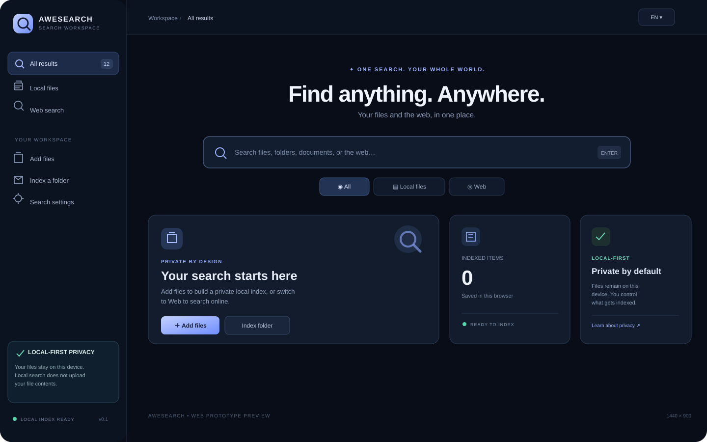
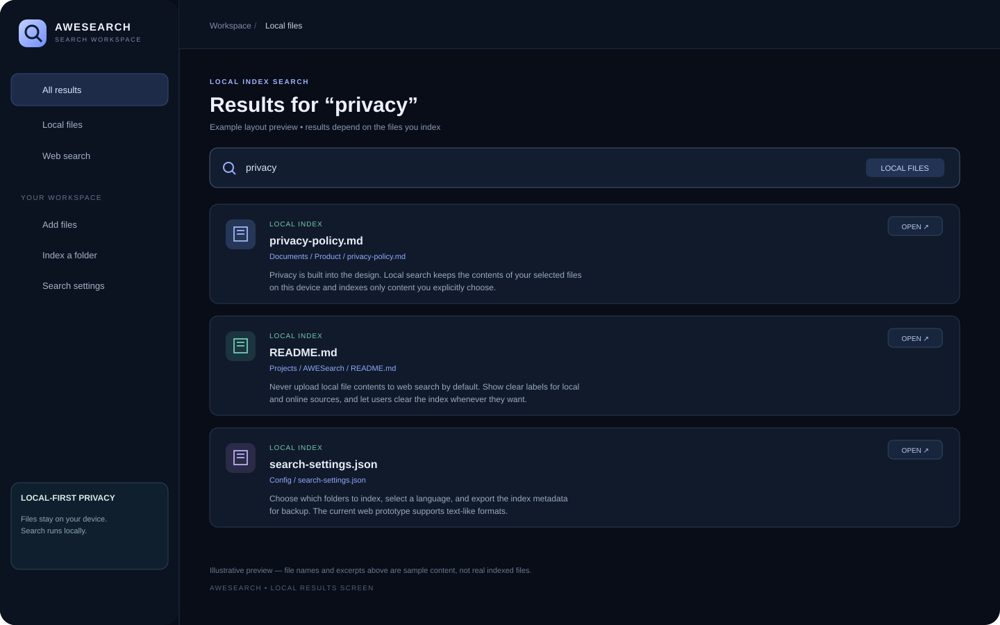
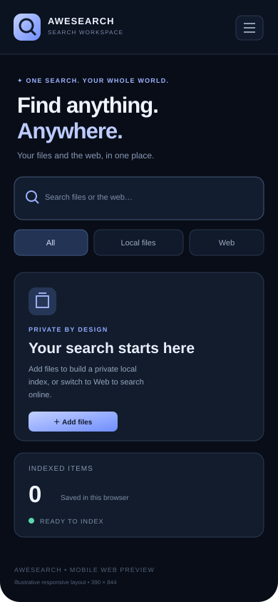

# AWESEARCH

**One search workspace for your local files and the open web.** AWESEARCH is an AWE ecosystem prototype for Android, Linux, Windows, macOS, and the web. The web app is usable now for browser-permitted local indexing and provider-based web searching; native capabilities remain in development.

## Current working web MVP

- **Local search:** choose files or a folder, index filenames and supported text, and search by filename, path, or content with relevance scoring and snippets.
- **Document extraction:** extract selectable text from PDFs up to 20 MB and 200 pages, plus DOCX text (bounded to 500,000 characters per file). Scanned PDFs require OCR and currently fall back to filename/metadata indexing; legacy `.doc` files are not supported.
- **Persistent local index:** IndexedDB first, with migration from the earlier localStorage index and a localStorage fallback where IndexedDB is unavailable.
- **File preview:** view text that was extracted into the index, inspect file metadata, and remove an item from the local index.
- **Web search:** choose DuckDuckGo, Google, or Bing. Queries open in a new tab at the chosen provider; the app does not upload local files or index content to the provider.
- **Appearance:** device-adaptive theme plus Glass, Aurora, Midnight, Light, and Minimal options; motion and glow effects can be toggled independently.
- **Languages:** English, Armenian, and Russian interface options.
- **Index management:** export a full searchable JSON backup (including extracted text), restore a validated backup, and clear the local index. Treat backups as private because they contain extracted document text.
- **Responsive layout:** desktop sidebar and mobile navigation.

## UI previews

These SVG preview images communicate the product direction. They are **illustrative previews**, not screenshots captured from a deployed production service.

### Desktop workspace



### Local search results



### Mobile responsive layout



## Known limitations — not yet a complete native product

- The web version can access only files and folders explicitly selected by the user. It cannot continuously scan arbitrary disk paths or watch folders in the background.
- Text extraction currently covers plain text, Markdown, HTML, JSON, CSV, XML/YAML, logs, common source-code formats, DOCX, and selectable text from bounded PDF files. Scanned-PDF/image OCR, legacy `.doc` extraction, and archive indexing are not implemented in the web MVP.
- Web search is delegated to the chosen search provider in a separate tab; the app does not yet display provider results inside its own results list or use a server-side search API.
- The file preview shows extracted text from the index. It cannot reopen an arbitrary local path automatically after the browser's file handle has been discarded.
- The Tauri shell is a scaffold. Native SQLite FTS5 indexing, incremental folder watchers, OS file-manager integration, and production installers still need implementation and platform testing.
- ASL (AWE Search Library) has a documented package and permission design, but package installation, signatures, sandboxing, and extension runtime are not implemented yet.
- Full browser-engine compatibility and AI-powered readers/helpers are future milestones, not features claimed as working today.

## Browser smoke tests and screenshots

GitHub Actions runs Playwright smoke tests against Chromium for homepage rendering, web/settings navigation, local text-file indexing and preview, and a narrow mobile viewport. The workflow uploads real browser screenshots and test traces as the `awesearch-browser-test-results` artifact when the run completes.

## Run the web MVP

Requirements: Node.js 20+.

```bash
npm install
npm run dev
npm run typecheck
npm run build
```

## Planned architecture

- **Web:** Vite + React; explicit user-selected file access and IndexedDB persistence.
- **Windows / macOS / Linux:** Tauri 2 desktop shell with native filesystem/indexing service.
- **Android:** Tauri 2 Android target with Android Storage Access Framework permissions and scoped folder access.
- **Native index:** SQLite FTS5, metadata, content hashes, incremental updates, and crash recovery.
- **Text extraction:** bounded, testable adapters for text/Markdown/HTML/CSV/JSON, followed by bounded PDF and DOCX formats.
- **ASL:** versioned, permission-declared extension bundles. See [docs/ASL.md](docs/ASL.md).
- **Detailed architecture and milestone gates:** [docs/ARCHITECTURE.md](docs/ARCHITECTURE.md).

## Security principles

1. Never index a folder without explicit consent.
2. Never upload local file content to web search or AI services by default.
3. Keep local and web results clearly labeled.
4. Treat extracted documents and extension packages as untrusted input.
5. Do not embed secret provider API keys in the client-side web build.
6. Do not claim full browser-engine support until a real engine is integrated and tested.
7. Do not claim a platform release until its build, permission model, and real-device behavior are tested.

## Release status

This is an actively developed MVP, not yet a production-complete cross-platform release. A passing CI build verifies the web typecheck and production bundle; it does not by itself certify native platforms, security, performance, or every browser/device.

## License

License decision pending.
